# COFCO Corporation (中粮集团): China's food-security champion at a triple cyclical trough

**Corporate analysis, initiation-style · Sector: Agribusiness & Food · Prepared 13 October 2026**

*Data basis: audited FY2025 group accounts (bond annual report), Lianhe Ratings reports, HKEX filings of COFCO Joycome and China Mengniu Dairy through H1 2026, and peer filings. Every number is in `data/` and `COFCO_Data_Pack.xlsx`, tagged to a source document in `resources/`. This is an educational analysis written in the style of a sell-side initiation. It is not investment advice and is not issued by any bank.*

---

## Contents

1. [Investment summary](#1-investment-summary)
2. [How to read this report (for first-time readers)](#2-how-to-read-this-report)
3. [Company primer: what COFCO is and how it is organised](#3-company-primer)
4. [Group financial analysis](#4-group-financial-analysis)
5. [Sector 1: Grains and oilseeds, the core engine](#5-sector-1-grains-and-oilseeds)
6. [Sector 2: Pork (COFCO Joycome), the swing factor](#6-sector-2-pork-cofco-joycome)
7. [Sector 3: Dairy (China Mengniu), the consumer franchise](#7-sector-3-dairy-china-mengniu)
8. [Putting it together: cycle map, linkages, scenarios](#8-putting-it-together)
9. [Peer scorecard](#9-peer-scorecard)
10. [Risks, catalysts and what to watch](#10-risks-catalysts-and-what-to-watch)
11. [Appendix: data tables, method, glossary](#11-appendix)

---

## 1. Investment summary

**Our view: a strong, state-backed franchise; earnings at a cyclical low; recovery staggered (pork, then grains, then dairy).**

| | |
|---|---|
| **What COFCO is** | China's largest state-owned food and agriculture group, and the country's main channel for importing grain and oilseeds. FY2025 revenue was **RMB 589bn** (about US$82bn). |
| **Credit standing** | AAA (Lianhe), stable. 100% owned by the central government (SASAC). |
| **FY2025 result** | Revenue -4.8% and pre-tax profit +2.3% to RMB 12.0bn. Profit quality was weaker than that headline: investment and fair-value gains (RMB 7.9bn) offset large impairments (RMB 7.4bn), and our estimate of the industrial core profit fell about 8%. |
| **Three vital sectors** | **Grains and oilseeds** (89% of revenue, 60% of gross profit), **pork** (COFCO Joycome, HK:1610), **dairy** (China Mengniu, HK:2319, largest shareholder) |
| **Where each sits in its cycle** | Grains: weak margins, rising volumes. Pork: deep trough in H1 2026 (hog price -30% YoY, Joycome lost RMB 1.1bn). Dairy: bottoming, with H1 2026 revenue +7.8%. |
| **Key debate** | Is 2025-26 a cyclical trough or a structural de-rating? We think it is mostly cyclical. China's sow herd is down 14% from its peak, which supports pork. Record soybean imports and the US purchase framework support grain volumes. Dairy supply is shrinking. |

**Five things to know**

1. **COFCO is a spread business, not a price business.** Its agri segment runs at a gross margin of about 5.8% on more than RMB 500bn of revenue. Profit comes from the gap between prices: origin vs destination, beans vs oil plus meal, hog price vs feed cost. Volatility helps; calm, oversupplied markets hurt.
2. **Each of the three businesses rides a different cycle.** In normal years one offsets another: in 2022 grain trading boomed while pork lost money. **2025 was the first year in which all three were weak at once** (Exhibit 13). That is why earnings look depressed.
3. **Pork is the biggest swing factor and will likely turn first.** Joycome's hog-farming segment swung from a RMB 0.24bn profit in H1 2025 to a **RMB 0.99bn loss** in H1 2026 on a 30% fall in hog prices. We estimate its cash breakeven at about **RMB 12.7/kg**. Government-led sow cuts should lift prices toward that level in 2027.
4. **Grain trading is past its 2022 peak, but COFCO's positioning is improving.** Revenue at COFCO International fell from US$53bn (2022) to US$34.5bn (2025), mostly because commodity prices fell. Industry net margins have halved since 2022 (ADM 4.3% → 1.3%). COFCO's Brazil infrastructure, record Chinese soybean imports (112mt in 2025) and the US-China purchase framework give it volume.
5. **Dairy has turned from a drag into a stabiliser.** Mengniu's reported profit collapsed in 2024 (RMB 0.1bn after a RMB 4.0bn Bellamy's impairment), which hit COFCO's share of associates' results (-RMB 1.5bn in 2024). Mengniu was back to +15.9% profit growth in H1 2026.

---

## 2. How to read this report

This report assumes **no prior knowledge**. Three ideas unlock almost everything that follows.

**Idea 1: "spread" vs "price."** A grain trader buys soybeans in Brazil at one price and sells them in China at another. Its profit is the **spread** between the two, minus freight and storage. If both prices rise together, the trader earns nothing extra. So "soybean prices are high" does not automatically mean "COFCO earns more." What matters is whether the **gaps** are wide.

**Idea 2: the hog cycle.** In China, pig prices move in a 3-4 year boom-bust cycle. High prices encourage farmers to keep more sows (mother pigs). About ten months later, more pigs arrive, prices crash, farmers lose money and cut sows, supply shrinks, and prices recover. Pork companies are **price takers**: they cannot control the price, only their cost.

**Idea 3: "consolidated" vs "associate."** COFCO *controls* some businesses and adds 100% of their revenue to its own accounts (consolidated). Others it only *part-owns*, recording just its share of their profit in one line (an associate). **Joycome (pork) is consolidated. Mengniu (dairy) is an associate.** That is why dairy does not appear in COFCO's revenue but still moves its profit.

A glossary is in the [Appendix](#11-appendix). Exhibits are in `charts/`.

---

## 3. Company primer

### 3.1 What COFCO does: a food pipeline from farm to table

```
FARMS (Brazil, Argentina, US, Black Sea, Australia, NE China)
   │  buy · store · ship ─────────── COFCO International (36 countries) · COFCO Trading (domestic grain)
   ▼
PORTS & PLANTS IN CHINA (200+ processing bases)
   │  crush soybeans → oil + meal ── COFCO Oils (33 plants, ~26mt/yr crush capacity)
   │  mill wheat & rice ──────────── COFCO Grains
   │  refine sugar, corn → ethanol ─ COFCO Sugar, COFCO Biotechnology
   ▼
CUSTOMERS
   ├─ Feed mills & farmers (soybean meal = pig feed) ──► COFCO Joycome (pork)
   ├─ Households (Fortune 福临门 oil, rice, flour, sugar) ► 4m+ retail outlets
   └─ Branded food & drink: China Foods (Coca-Cola bottling), China Tea, Jiugui liquor,
      Great Wall wine; Mengniu dairy (associate)
```

The pipeline matters because **a shock at one end travels along it.** When pig farmers cut their herds, they buy less soybean meal, and COFCO's crushing margins fall. Pork and grain profits are therefore linked.

### 3.2 Ownership, mandate and structure

- **Owner:** 100% held by SASAC, the central government body that owns China's large state firms. Since 2016-17 COFCO has been a pilot "state capital investment company": the parent manages a portfolio of 17 specialised professional companies.
- **Listed vehicles:** 14 listed companies. On the mainland: COFCO Sugar, COFCO Capital, Grandjoy (Joy City), COFCO Technology & Industry, COFCO Biotechnology, Jiugui Liquor, Milkground. In Hong Kong: China Foods, Joy City Property, **COFCO Joycome**, **China Mengniu**, China Modern Dairy, China Shengmu and Fountain Set.
- **Policy mandate:** COFCO is China's main channel for agricultural imports and exports, and the largest builder of the "north grain south" logistics corridor. It ranks No. 1 among domestic grain distributors by volume. In practice it is expected to **buy when private firms will not**. In late 2025, COFCO and the state reserve agency Sinograin were the only buyers of US soybeans under the US-China truce. The benefits are cheap funding, import access and implicit support. The cost is periodic below-market trades. Our shorthand: COFCO's earnings are **commercial earnings minus a national-service cost**.

### 3.3 Scale versus global peers

| Company | 2025 revenue (US$bn) | Ownership | Profit disclosed? |
|---|---:|---|---|
| Cargill | ~160 (private, FY to May) | Family | Partially |
| **COFCO Corporation (group)** | **~82** | State (China) | Yes (bond filings) |
| ADM | 80.3 | Listed (US) | Yes |
| Wilmar | 70.4 | Listed (SG) | Yes |
| Bunge (incl. Viterra from Jul-25) | 70.3 | Listed (US) | Yes |
| Louis Dreyfus | 53.2 | Family | Yes |
| COFCO International (subsidiary) | 34.5 | State (via COFCO) | Revenue only |

*Sources: T1-T4, G3, C4. COFCO converted at RMB 7.2/US$. Cargill is approximate.*

---

## 4. Group financial analysis

### 4.1 Revenue and profit: down from the 2022 peak

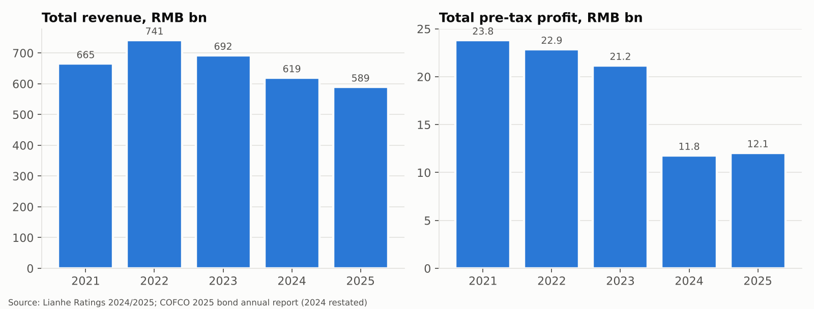

**Exhibit 1: COFCO group revenue and pre-tax profit, 2021-2025**

| RMB bn | 2021 | 2022 | 2023 | 2024* | 2025 |
|---|---:|---:|---:|---:|---:|
| Total revenue | 665.0 | 741.4 | 692.1 | 619.0 | 589.1 |
| YoY | | +11.5% | -6.7% | -10.6% | -4.8% |
| Pre-tax profit | 23.8 | 22.8 | 21.2 | 11.8 | 12.0 |
| Pre-tax margin | 3.6% | 3.1% | 3.1% | 1.9% | 2.0% |
| Net profit to parent | n/a | n/a | n/a | 1.87 | 2.41 |
| Liabilities / assets | 70.4% | 69.0% | 65.4% | 63.3% | 64.6% |

*\*2024 restated for an accounting-policy change. As originally reported: revenue RMB 635.0bn, pre-tax profit RMB 8.2bn. Sources: G1-G3.*

**What happened, in plain terms:**

- **Revenue fell 21% from 2022 to 2025.** About 89% of revenue is commodity trading, so revenue tracks commodity *prices*. Soybean, corn and wheat prices fell sharply from their 2022 war-driven highs. Lower revenue mostly reflects lower prices, not lower activity.
- **Pre-tax profit halved in 2024.** Three things hit at once. Grain margins compressed, the property arm (Joy City) took large impairments, and Mengniu's write-down of Bellamy's flowed through COFCO's associates line (-RMB 1.5bn).
- **2025 was flat at the headline level but weaker underneath** (next section).

### 4.2 Quality of 2025 profit

| RMB bn | 2024 | 2025 | Change | Comment |
|---|---:|---:|---:|---|
| Gross profit (operating revenue - cost of sales) | 50.5 | 50.1 | -0.4 | Thinner grain margins, lower food margins |
| Less: taxes & surcharges, selling, admin, R&D, finance costs | -39.9 | -40.4 | -0.5 | Cost base broadly flat |
| **≈ Industrial core profit (our estimate)** | **10.6** | **9.7** | **-8%** | The engine slowed |
| Investment income | 0.2 | 5.6 | +5.4 | Disposals; associates swung from -1.5 to +0.2 |
| Fair-value gains | 0.4 | 2.3 | +2.0 | Market-driven, non-recurring |
| Asset impairments | -3.4 | -7.4 | -4.0 | Mainly property inventories |
| **Pre-tax profit** | **11.8** | **12.0** | **+0.3** | |
| Income tax | -6.8 | -6.2 | | Effective rate about 51%: losses at some subsidiaries cannot be used against tax at others |
| Net profit | 5.0 | 5.9 | | Minority holders take about 59% (listed subsidiaries) |

*Source: G3 income statement. "Industrial core" excludes the insurance and interest lines of COFCO Capital and is our simplification.*

**Read-across:** about RMB 7.9bn of 2025 profit came from investment and market gains, which are unlikely to repeat. Impairments of RMB 7.4bn may not repeat either. So the sustainable earnings base is roughly the RMB 10bn of "industrial core" profit, and it needs grains and pork to recover to grow.

### 4.3 Where the money is made: segments

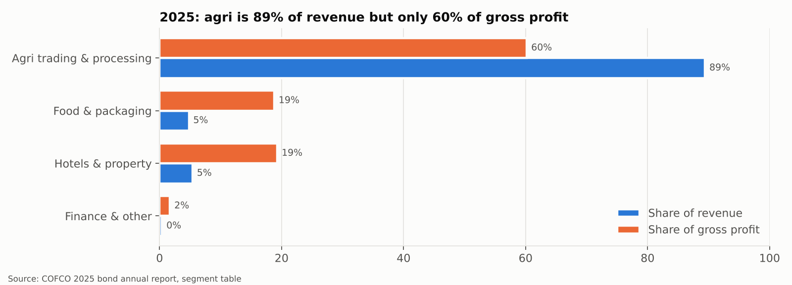

**Exhibit 2: 2025 share of revenue vs share of gross profit**

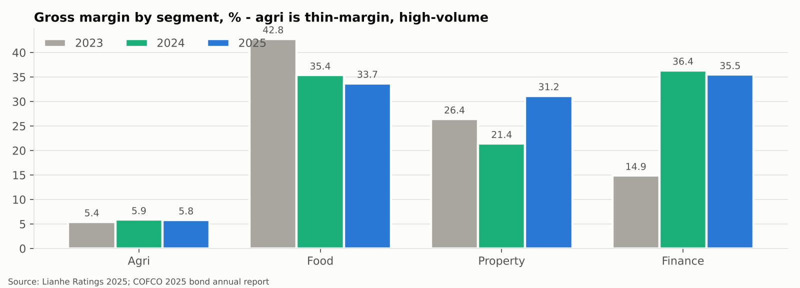

**Exhibit 3: gross margin by segment, 2023-2025**

| Segment (RMB bn) | Revenue 2023 | Revenue 2024 | Revenue 2025 | GM 2023 | GM 2024 | GM 2025 | Gross profit 2025 |
|---|---:|---:|---:|---:|---:|---:|---:|
| Agri trading & processing (incl. pork) | 600.7 | 543.2 | 518.2 | 5.4% | 5.9% | 5.8% | 30.2 |
| Food & packaging | 30.5 | 28.4 | 28.0 | 42.8% | 35.4% | 33.7% | 9.4 |
| Hotels & property | 36.9 | 35.9 | 31.0 | 26.4% | 21.4% | 31.2% | 9.7 |
| Finance & other | 4.6 | 2.4 | 2.4 | 14.9% | 36.4% | 35.5% | 0.8 |

*Sources: G1, G3.*

**Why we pick grains, pork and dairy as the three vital sectors.**
- **Grains and oilseeds** is the core by every measure: 89% of revenue, 60% of gross profit, and the centre of the state mandate.
- **Pork** sits inside the agri segment. It is the largest single source of profit volatility, because Joycome's results swung by RMB 3.2bn between 2020 and 2022. Pork prices also feed directly into China's CPI.
- **Dairy (Mengniu)** is COFCO's largest consumer franchise. Mengniu's revenue of RMB 82bn is bigger than COFCO's entire food segment. It moves group profit through the associates line and is the group's most valuable listed holding.
- **Property (Joy City)** earns a similar gross profit to food, but SASAC policy is to shrink non-core real estate. We treat it as a source of impairment risk (Section 10), not a strategic engine.

### 4.4 Balance sheet and credit

| RMB bn | 2023 | 2024 | 2025 |
|---|---:|---:|---:|
| Total assets | 730.7 | 693.8 | 721.6 |
| Cash | 114.8* | 71.9 | 66.0 |
| Interest-bearing borrowings (short + long + bonds + current portion) | 231.6* | 189.1 | 186.7 |
| Liabilities / assets | 65.4% | 63.3% | 64.6% |
| Inventories | n/a | 166.2 | 158.6 |

*\*2023 per Lianhe definitions (cash-like assets; "total debt"), so not strictly comparable. Sources: G1, G3.*

**Credit view:** leverage is moderate for a commodity trader, and inventories (RMB 159bn) are mostly liquid grain. The 2024 total-debt/EBITDA multiple of 7.7x, as originally reported, is high, but that reflects trough EBITDA rather than rising debt: interest-bearing borrowings eased from RMB 189bn (2024) to RMB 187bn (2025), and Lianhe's broader total-debt measure fell from RMB 232bn (2023) to RMB 201bn (2024). Undrawn bank facilities were about RMB 600bn (Lianhe, March 2025). We see no stress. The AAA rating rests on state ownership and strategic importance as much as on stand-alone metrics.

---

## 5. Sector 1: Grains and oilseeds

### 5.1 Business model

| Layer | Entity | Assets | How it earns |
|---|---|---|---|
| **Global origination & trading** | COFCO International (Geneva) | Offices in 36 countries; terminals at Santos (Brazil), Rosario (Argentina), St Louis (US) and Constanța (Romania); about 32mt storage and 29mt port capacity (2022 fact sheet) | Buys from farmers and sells to crushers and millers worldwide, about 80% of Brazil exports going to China. Earns the **origin-to-destination spread** plus logistics. |
| **Domestic grain trading & logistics** | COFCO Trading | Storage above 30mt; about 22mt/yr port throughput; Beiliang port (Dalian), the largest grain port | Moves corn, wheat and rice from north-east China to the consuming south. Earns **storage and arbitrage over time**. |
| **Oilseed processing** | COFCO Oils (brand: Fortune 福临门) | 33 plants; crush capacity about 26mt/yr; refining above 7mt | **Crush margin** = value of oil plus meal minus bean cost |
| **Flour, rice, sugar, corn processing** | COFCO Grains, COFCO Sugar, COFCO Biotech | Mills, sugar refineries, ethanol and starch plants | Processing margins and branded premiums |

*Sources: G1, C3, C6.*

**Scale in context:** COFCO Oils' 26mt crush capacity is equal to about **23% of China's 2025 soybean imports** (112mt). COFCO's Brazil exports of about 18mt (80% to China) supply roughly **one eighth** of China's imports.

### 5.2 Operating performance

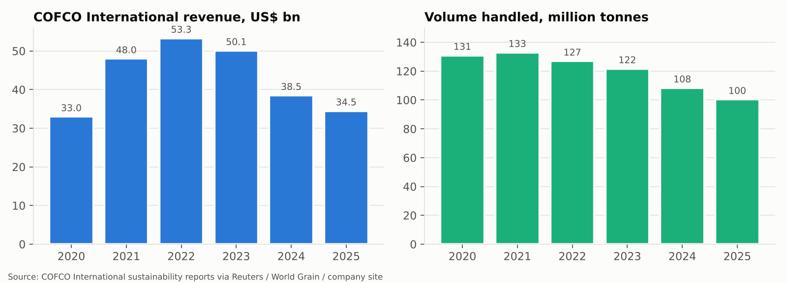

**Exhibit 4: COFCO International revenue and volume**

| | 2020 | 2021 | 2022 | 2023 | 2024 | 2025 |
|---|---:|---:|---:|---:|---:|---:|
| Revenue (US$bn) | 33.0 | 48.0 | 53.3 | 50.1 | 38.5 | 34.5 |
| Volume (mt) | 131 | 133 | 127 | 122 | 108 | 100 |
| **Revenue per tonne (US$)** | 252 | 361 | 420 | 412 | 355 | 344 |

*Sources: C1-C4. 2020-21 volumes are total traded volume; later years are third-party sales. Profit is not disclosed.*

**Decomposition:** from 2022 to 2025, revenue fell 35%. **Price** explains about 18 points (revenue per tonne fell from US$420 to US$344) and **volume** about 21 points (127mt to 100mt). The volume decline is partly deliberate. Management has shifted from chasing low-margin third-party flows toward origination it controls (Brazil) and to serving China.

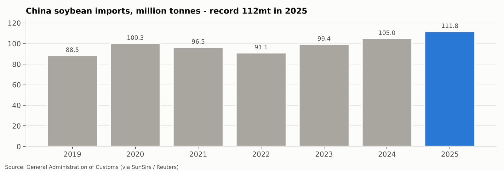

**Exhibit 6: China's soybean imports hit a record 112mt in 2025**

**The story in three phases:**

1. **2020-2022, boom.** COVID logistics chaos, China rebuilding its pig herd after African swine fever (strong meal demand), and then the Russia-Ukraine war produced the widest spreads in a decade. Revenue per tonne rose about 65%, and the whole industry posted record profits (Exhibit 5).
2. **2023-2024, normalisation.** Record South American crops and healed supply chains brought falling prices and compressed spreads. Group agri gross profit slipped from RMB 32.6bn (2023) to RMB 31.9bn (2024).
3. **2025-2026, political disruption.** China stopped buying US soybeans for most of 2025, so imports concentrated on Brazil, where COFCO's Santos investment paid off. Domestic crushing was squeezed: imports were front-loaded (record volumes), and hog farmers were cutting herds (weak meal demand). After the truce, COFCO and Sinograin bought the **12mt of US soybeans** China pledged, even though private crushers preferred cheaper South American beans. China also committed to **25mt a year in 2026-28**. Agri gross profit eased again to **RMB 30.2bn** in 2025, with the margin steady at 5.8% and revenue down 4.6%.

### 5.3 Peer comparison

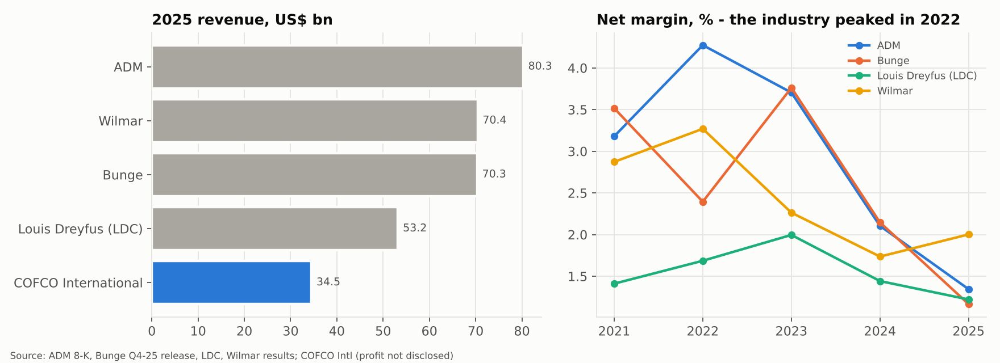

**Exhibit 5: global trader revenue (2025) and net margin trend**

| US$bn | Revenue 2022 | Revenue 2025 | Net income 2022 | Net income 2025 | Net margin 2022 | Net margin 2025 |
|---|---:|---:|---:|---:|---:|---:|
| ADM | 101.6 | 80.3 | 4.34 | 1.08 | 4.3% | 1.3% |
| Bunge | 67.2 | 70.3 | 1.61 | 0.82 | 2.4% | 1.2% |
| Louis Dreyfus | 59.9 | 53.2 | 1.01 | 0.65 | 1.7% | 1.2% |
| Wilmar | 73.4 | 70.4 | 2.40 | 1.41 | 3.3% | 2.0% |
| COFCO International | 53.3 | 34.5 | n/d | n/d | n/d | n/d |
| *COFCO group (all segments), pre-tax margin* | | | | | *3.1%* | *2.0%* |

*Sources: T1-T4, C1-C4, G3. Wilmar 2025 includes a US$1.14bn one-off gain (core net profit US$1.28bn). Bunge 2025 includes Viterra from July.*

**Takeaways:**
- **The industry downturn is general, not COFCO-specific.** Every listed peer's margin roughly halved from 2022 to 2025. ADM's adjusted EPS fell 28% in 2025 alone.
- **COFCO International is the smallest of the "ABCD+" group by revenue and shrank fastest.** Part of that is its China focus (fewer third-party flows). Part may be share loss. The absence of profit disclosure is a governance gap compared with every listed peer.
- **Wilmar is the closest analogue.** It has the same China crushing exposure (through Yihai Kerry), and its 2H25 recovery in crush margins is a positive read-across for COFCO Oils.

### 5.4 Why grain earnings fluctuate: the driver map

| Driver | Effect on COFCO | Mechanism | 2025-26 status |
|---|---|---|---|
| Price **volatility** (weather, war, trade disputes) | + trading | Wider arbitrage and basis opportunities | Moderate (trade-war volatility, otherwise ample crops) |
| Global harvest size | Big crops = lower prices, calmer markets: − trading | Spreads compress | Record Brazil crops: − |
| China hog herd → meal demand | + crush margin | Soybean meal is the main pig-feed protein | Sow cuts: − near term |
| Policy purchases (US beans, state reserves) | − margin, + volume | Strategic buying above market | Active: − margin |
| Freight and FX (BRL, USD/RMB) | ± | Landed cost and timing | Neutral |
| Hedging and mark-to-market | Noise | Timing gaps between physical and futures | Contributed to 2025 fair-value gains |

### 5.5 Outlook for grains

We expect **gradual improvement in 2026-27**. Four factors support this. (1) The sow herd is stabilising near its "normal" level, which should firm meal demand. (2) Wilmar's 2H25 data suggest the China crush cycle has turned. (3) The US purchase framework adds 25mt a year of state-directed volume, though at lower margins. (4) Weather or geopolitical shocks are upside risks, because they widen spreads. **The structural trend is positive.** Beijing wants a Chinese company to control the import chain end to end, and COFCO is the designated vehicle.

---

## 6. Sector 2: Pork (COFCO Joycome)

### 6.1 Business model

COFCO Joycome (中粮家佳康, HK:1610) is an integrated pork producer with five segments: **hog production**, **feed**, **fresh pork** (slaughter plus branded chilled pork: "Joycome" and linseed-fed pork), **processed meat**, and **meat import**. The economics are simple: **profit per kg = hog price - cost per kg.** Cost (feed about 60%, plus piglets, labour, vet and depreciation) moves slowly. Price moves violently. So almost all profit volatility comes from price.

### 6.2 Operating performance

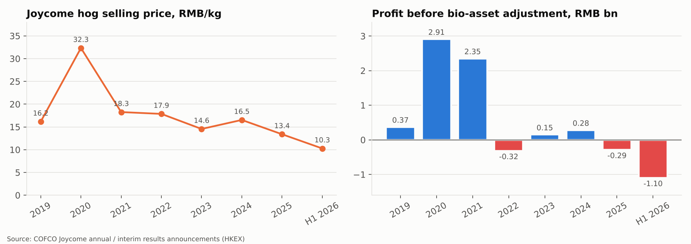

**Exhibit 7: Joycome hog price vs profit before biological-asset adjustment**

| | 2019 | 2020 | 2021 | 2022 | 2023 | 2024 | 2025 | H1 2025 | H1 2026 |
|---|---:|---:|---:|---:|---:|---:|---:|---:|---:|
| Hog selling price (RMB/kg) | 16.16 | 32.33 | 18.26 | 17.86 | 14.55 | 16.53 | 13.39 | 14.59 | 10.27 |
| Hogs produced (m head) | 1.99 | 2.05 | 3.44 | 4.10 | 5.20 | 3.56 | n/d | n/d | n/d |
| Revenue (RMB bn) | 11.1 | 18.9 | 13.2 | 12.9 | 17.2 | 16.3 | 18.6 | 9.0 | 8.7 |
| Profit before bio-asset adjustment (RMB bn) | 0.37 | 2.91 | 2.35 | -0.32 | 0.15 | 0.28 | -0.29 | 0.20 | -1.10 |
| Profit after bio-asset adjustment (RMB bn) | 1.52 | 4.02 | -0.48 | 0.36 | -0.03 | 0.55 | -0.74 | 0.32 | -1.56 |
| Fresh pork sold ('000 t) | 146 | 109 | 166 | 231 | 245 | 262 | 341 | 150 | 197 |

*Sources: J1-J6.*

**Year-by-year, with the reason behind each swing:**
- **2019-20, boom.** African swine fever wiped out a large share of China's herd. Prices doubled to RMB 32/kg and Joycome earned RMB 2.9bn.
- **2021, collapse in price, profit held.** The industry rebuilt too fast and prices nearly halved. Joycome still earned RMB 2.35bn before adjustment, helped by a 68% volume increase and stock bought earlier. After adjustment it lost money, because the value of its live herd was marked down.
- **2022, loss.** Prices were flat, but feed costs rose sharply as corn and soybean meal spiked during the war.
- **2023, near breakeven.** Prices hit a trough (RMB 14.6/kg), but feed costs eased.
- **2024, recovery.** Industry sow cuts lifted prices 14%. Joycome cut hog volume 32% and returned to profit.
- **2025, back to loss.** Prices fell 19% and **volume rose sharply.** Hog-segment revenue grew 39% while the price fell 19%, which implies roughly 70% more weight sold. Joycome expanded into a falling market.
- **H1 2026, deep trough.** National prices hit a multi-year low of RMB 8.7/kg in April. Joycome's price was -30% YoY, and it lost RMB 1.1bn.

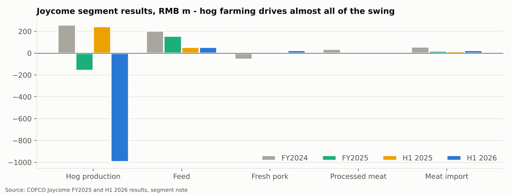

**Exhibit 8: segment results (RMB m). Hog farming is the whole story.**

| RMB m | FY2024 | FY2025 | H1 2025 | H1 2026 |
|---|---:|---:|---:|---:|
| Hog production | 258.6 | -159.1 | 243.9 | **-993.7** |
| Feed | 202.4 | 157.9 | 55.8 | 54.8 |
| Fresh pork | -57.2 | -5.6 | -4.3 | **+24.4** |
| Processed meat | 35.5 | 6.1 | 6.2 | -12.2 |
| Meat import | 58.2 | 19.9 | 15.8 | 24.0 |

*Source: J1, J2. Segment results before fair-value adjustments, corporate costs and finance costs.*

The non-hog businesses (feed, fresh pork, import) are **stable and slightly profitable**. Fresh pork turned positive in H1 2026, helped by cheap hogs (its input) and a branded mix that reached 34.7% of the business. That is the natural hedge: when hogs are cheap, the slaughter-and-brand business does better.

### 6.3 Analytics: breakeven and sensitivity

Using segment data (approximate, because the segment includes inter-segment and piglet sales):

| | FY2025 | H1 2026 |
|---|---:|---:|
| Hog segment revenue (RMB bn) | 8.88 | 4.23 |
| Hog segment result (RMB bn) | -0.16 | -0.99 |
| Implied total cost (RMB bn) | 9.04 | 5.22 |
| Selling price (RMB/kg) | 13.39 | 10.27 |
| **Implied all-in breakeven (RMB/kg)** | **≈13.6** | **≈12.7** |
| Implied live weight sold (mt, annualised) | ≈0.66 | ≈0.82 |

**Reading this:** Joycome's breakeven fell about RMB 0.9/kg between FY2025 and H1 2026 as feed got cheaper and herd efficiency improved, a real operational gain. But prices fell RMB 4.3/kg. **Each RMB 1/kg change in the hog price moves annual profit by about RMB 0.8bn** at current volumes. That is larger than Joycome's best "normal" year since 2021. Pork is the single biggest swing factor in COFCO's industrial earnings.

### 6.4 Peer comparison

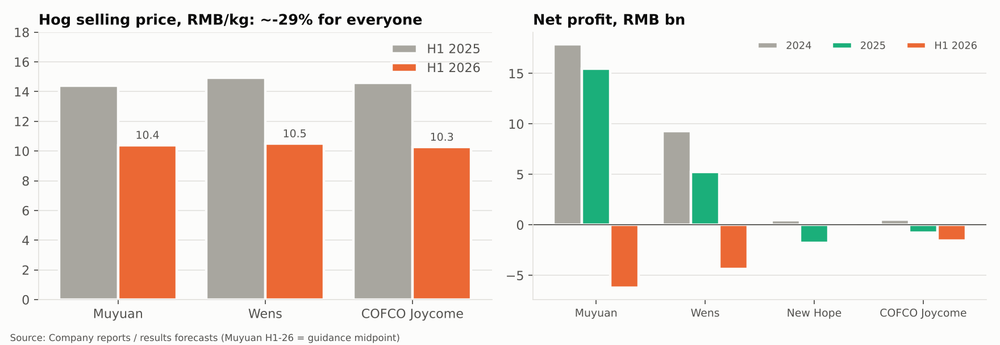

**Exhibit 9: everyone took the same price hit; scale and cost decide who survives it**

| | Muyuan | Wens | New Hope | COFCO Joycome |
|---|---:|---:|---:|---:|
| Hogs sold 2025 (m) | 77.98 | 40.48 | 17.55 | ~5-6 (our estimate) |
| Net profit 2024 (RMB bn) | 17.88 | 9.28 | 0.47 | 0.54 |
| Net profit 2025 (RMB bn) | 15.49 | 5.27 | -1.78 | -0.75 |
| Net profit H1 2026 (RMB bn) | ≈-6.2 (guidance midpoint) | -4.37 | n/a | -1.55 |
| Hog price H1 2026 (RMB/kg) | ~10.4 | 10.50 | n/a | 10.27 |
| Hog price change YoY | ~-28% | -29.7% | n/a | -29.6% |

*Sources: P1-P3, J1, J2.*

**Takeaways:**
- **Joycome is a small player**, roughly 1/13th of Muyuan's volume. It is a pure price taker.
- **Its cost position is mid-pack, not leading.** Muyuan stayed profitable through 2025 because its cost is about RMB 1-2/kg lower. Joycome turned loss-making in 2025 while Muyuan and Wens were still earning.
- **Its differentiation is downstream.** The branded chilled-pork share (34.7%), linseed-fed pork (+135% volume in 2025) and the COFCO feed synergy are not available to pure farmers. They dampen, but do not offset, the farming cycle.

### 6.5 The national cycle: why we expect a 2027 recovery

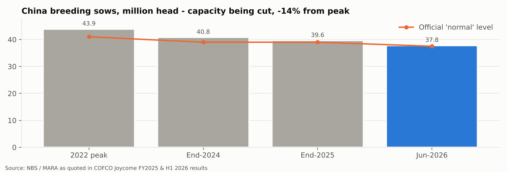

**Exhibit 10: China breeding sows (million head)**

- The sow herd peaked at **43.9m in 2022**. It stood at **37.8m in June 2026 (-14%)**, now only 0.8% above the official "normal" level of 37.5m. The Ministry of Agriculture lowered that reference level in 2025-26 as part of the anti-"involution" campaign against destructive over-competition, which pressed large producers to cut sows and slaughter weights.
- With a lag of about ten months between sow decisions and market hogs, **today's lower sow herd means less pork supply from late 2026 into 2027.**
- **The offset:** productivity per sow keeps rising (more piglets per sow per year), and pork output still rose 3.3% in H1 2026. Recovery may therefore be slower and shallower than in past cycles.

**Base case:** Joycome's losses narrow in H2 2026, and it returns to profit in 2027 as prices recover toward RMB 13-14/kg, above its RMB 12.7 breakeven.

---

## 7. Sector 3: Dairy (China Mengniu)

### 7.1 The relationship

China Mengniu Dairy (蒙牛乳业, HK:2319) is one of China's two dairy leaders; Yili is the other. COFCO is its **largest shareholder** and appoints key management. **Mengniu is equity-accounted:** its profit enters COFCO's accounts as "share of associates." COFCO's dairy reach extends to **China Modern Dairy** and **China Shengmu** (raw-milk farms) and **Milkground** (cheese), through Mengniu and directly.

**Mengniu's 2025 revenue mix:** liquid milk 79% (Milk Deluxe 特仑苏 premium, chilled yogurt, Shiny Meadow fresh milk), ice cream 6.5%, cheese 6.4%, milk formula and others 8.1%. Profit depends on **brand pricing power and volume** (consumer demand) minus **raw-milk cost**.

### 7.2 Operating performance

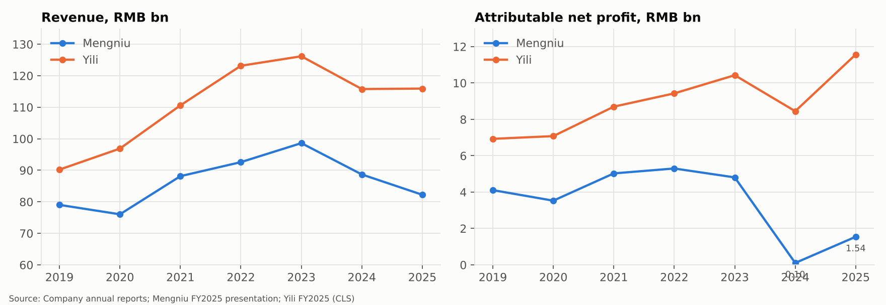

**Exhibit 11: Mengniu vs Yili revenue and net profit**

| RMB bn | 2019 | 2020 | 2021 | 2022 | 2023 | 2024 | 2025 | H1 2025 | H1 2026 |
|---|---:|---:|---:|---:|---:|---:|---:|---:|---:|
| Revenue | 79.0 | 76.0 | 88.1 | 92.6 | 98.6 | 88.7 | 82.2 | 41.6 | 44.8 |
| YoY | | -3.8% | +15.9% | +5.0% | +6.5% | -10.1% | -7.3% | | +7.8% |
| Net profit (reported) | 4.11 | 3.53 | 5.03 | 5.30 | 4.81 | 0.10 | 1.55 | 2.05 | 2.37 |
| Net profit (adjusted) | | | | | | 4.44 | 3.96 | | |
| Gross margin | | | | | | 39.6% | 39.9% | 41.7% | 40.8% |

*Sources: D1-D3. Adjusted = excluding the Bellamy's impairment and associate one-offs, per Mengniu.*

**Three phases:**
1. **2019-2023, growth.** The pandemic boosted health awareness, and premiumisation followed: consumers traded up to Milk Deluxe and similar. Revenue grew 25% over four years.
2. **2024-2025, slump.** Revenue fell 17% from the peak. In 2025 volume fell 4% and price/mix about 3%. Reported profit collapsed in 2024 on a **RMB 4.0bn impairment of Bellamy's** (an Australian infant-formula brand bought in 2019) and losses at dairy-farm associates. Underlying (adjusted) profit fell a more modest 11% in 2025.
3. **H1 2026, turn.** Revenue +7.8% and profit +15.9%. Fresh milk, cheese (+33%) and formula grew strongly, liquid milk returned to growth (+5%), and associates swung back to profit. Gross margin dipped 0.9pt, because the cheap-milk tailwind is fading and some basic products were cut in price.

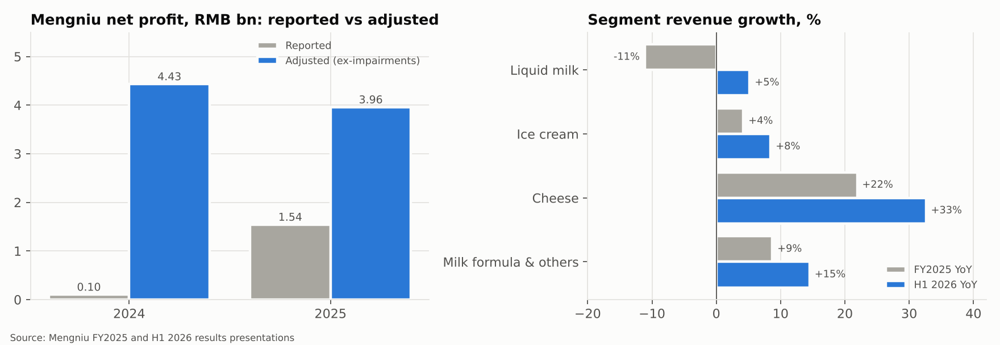

**Exhibit 12: reported vs adjusted profit; segment growth**

### 7.3 Why dairy fluctuated: four overlapping causes

| Cause | Mechanism | Effect on Mengniu |
|---|---|---|
| **1. Weak consumer** | The property downturn hit household confidence. Premium milk is an easy item to trade down; NielsenIQ showed total dairy sales -9.7% YoY in May 2026 | Volume and mix down |
| **2. Raw-milk glut** | High milk prices in 2020-22 drove herd expansion. By 2023-25, supply exceeded demand and farm-gate prices fell to about RMB 3/kg, below the ~RMB 3.2/kg production cost | **+ cost** (cheaper milk, higher gross margin) but **− price** (industry discounting) and **− associates** (farm losses, cow write-downs) |
| **3. Demographics** | Births fell sharply | Infant-formula market shrank, which triggered the Bellamy's impairment |
| **4. Competition and channels** | Yili's scale advantage; discount stores, community group-buying and livestream e-commerce | Pricing pressure |

**The raw-milk cycle is now turning.** China's dairy-cow herd fell from 6.6m (2023) to 6.3m (2025) and was down another 4.3% YoY by June 2026, with nearly 20% of farms exiting. Farm-gate milk was RMB 3.05/kg in July 2026, the first YoY gain (+0.3%). That is good for Mengniu's associates and for industry pricing discipline. It is mildly negative for gross margin.

### 7.4 Peer comparison: Mengniu vs Yili

| | Mengniu | Yili |
|---|---:|---:|
| Revenue 2025 (RMB bn) | 82.2 (-7.3%) | 115.9 (+0.1%) |
| Net profit 2025 (RMB bn) | 1.55 (adjusted 3.96) | 11.57 (+36.8%) |
| Net margin 2025 | 1.9% (adjusted 4.8%) | 10.0% (record) |
| Revenue H1 2026 | 44.8 (+7.8%) | 64.5 (+4.1%) |
| Net profit H1 2026 | 2.37 (+15.9%) | 5.76 (-20.0%, Ausnutria goodwill impairment) |

*Sources: D1, D2, D5, D6.*

**Takeaway:** Yili widened its lead in 2023-25. Its revenue is about 40% larger and its margin far higher, partly because Mengniu carried more problem acquisitions. In H1 2026 the momentum flipped: Mengniu grew faster and Yili took its own formula impairment. The lesson is that **overseas infant-formula acquisitions destroyed value for both leaders.**

### 7.5 Outlook for dairy

Mengniu has raised its 2026 growth target to "high single digits." We see **2026 as stabilisation and 2027 as modest growth**, driven by cheese, fresh milk, B2B ingredients (where surplus milk turns into bakery and tea-chain inputs rather than distressed milk powder) and Southeast Asia (Aice ice cream is No. 1 in Indonesia). A full recovery in liquid milk needs consumer confidence, which COFCO cannot control. **For COFCO, the main effect is the associates line**, which swung from -RMB 1.5bn (2024) to +RMB 0.2bn (2025) and should improve further.

---

## 8. Putting it together

### 8.1 The cycle map

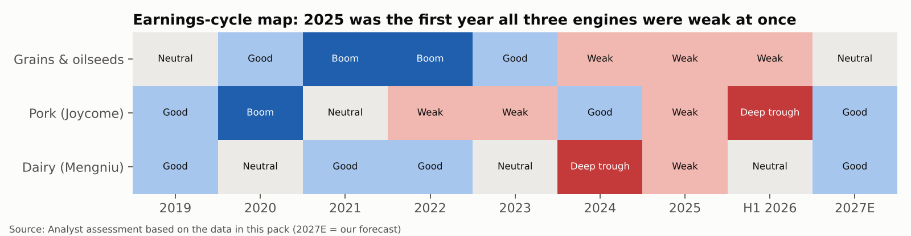

**Exhibit 13: earnings-cycle position by sector (analyst assessment)**

| | Grains & oilseeds | Pork | Dairy |
|---|---|---|---|
| Nature | Commodity spread / processing margin | Commodity price minus farm cost | Branded consumer goods |
| Main driver | Volatility, trade flows, crush margin | National hog price | Consumer demand; raw-milk cycle |
| Typical cycle | Irregular, event-driven | 3-4 years | Multi-year |
| Position now | Weak margins, volume improving | Trough, recovery 2027 | Bottoming, turning |
| COFCO's control over outcome | Medium (assets, network) | Low (price taker) | Medium (brand, cost) |
| Accounting route into COFCO | Consolidated, 89% of revenue | Consolidated (inside agri) | Associate (share of profit) |

### 8.2 How the sectors amplify each other

1. **Pork → grains.** Fewer pigs means less soybean meal demand, and the crush margin falls. In 2025-26 both were weak together.
2. **Grains → pork.** Cheap corn and meal lower Joycome's cost: its breakeven fell from RMB 13.6/kg to RMB 12.7/kg.
3. **Grains → dairy.** Cows eat corn and meal too. Cheap feed helps dairy-farm associates, but it also prolonged the milk glut.
4. **Consumer → pork and dairy.** Weak household confidence hits premium milk and branded pork together.

Normally one engine offsets another: 2022 was a grain boom with a pork loss, and 2024 was a pork recovery with a dairy slump. **In 2025 all three were weak at once.** That is the core reason group profit looks depressed.

### 8.3 Scenarios for 2027 (illustrative)

| | Bear | **Base** | Bull |
|---|---|---|---|
| China hog price (RMB/kg) | 11 | **13.5-14** | 17 |
| Joycome pre-adjustment profit* | ≈ -RMB 1.2bn | **≈ +RMB 0.8-1.2bn** | ≈ +RMB 3.5bn |
| China crush margin | Weak (meal glut persists) | **Normal** | Strong (weather shock) |
| Grain trading | Calm, oversupplied | **Moderate recovery** | Volatility spike |
| Mengniu | Flat revenue, more impairments | **Mid-to-high single-digit growth** | Consumer rebound |
| Group pre-tax profit vs 2025 | Lower (no one-off gains) | **Similar, but higher quality** | Materially higher |

*\*Using our ~RMB 12.5/kg breakeven and ~0.8mt annual live weight. Illustrative arithmetic, not a forecast model.*

**Why "similar" in the base case:** the operating recovery (a pork swing of about +RMB 1-1.5bn, plus grains and associates) roughly replaces the RMB 7.9bn of 2025 investment and fair-value gains that will not recur, net of lower impairments. The *mix* of earnings improves, and so does their sustainability.

---

## 9. Peer scorecard

A qualitative scorecard (★★★ = best in peer set):

| Dimension | COFCO grains vs ABCD+Wilmar | Joycome vs Muyuan/Wens | Mengniu vs Yili |
|---|---|---|---|
| Scale | ★★ (COFCO International smallest of five; group ~#2-3) | ★ (~1/13th of Muyuan) | ★★ (No. 2) |
| Cost position | ★★ | ★★ (mid-pack breakeven) | ★★ |
| Margin 2025 | n/d for COFCO International; group 2.0% pre-tax vs peers ~1.2-2.0% net | ★ (loss; peers profitable) | ★ (1.9% vs 10.0%) |
| Momentum (latest period) | ★★ (volume support) | ★ (deep trough) | ★★★ (H1 26 beat Yili) |
| Strategic moat | ★★★ (state mandate, China access, Brazil ports) | ★★ (brand, chain integration) | ★★ (brand, distribution) |
| Disclosure | ★ (no COFCO International profit) | ★★★ (detailed HKEX filings) | ★★★ |

---

## 10. Risks, catalysts and what to watch

### 10.1 Key risks

| Risk | Impact | Probability | Comment |
|---|---|---|---|
| Hog capacity cuts fail (productivity gains, small farmers re-enter) | High | Medium | Recovery slips to 2028 |
| Renewed US-China trade conflict | Medium | Medium | More policy buying, route disruption |
| Further property impairments (Joy City) | Medium | Medium-High | RMB 7.4bn impairments in 2025; the sector is still bottoming |
| Consumer weakness persists | Medium | Medium | Hits Mengniu, China Foods, branded pork |
| Disease (ASF, avian flu, FMD) | High for affected herds | Low-Medium | Can *raise* prices for survivors |
| Expanded policy mandate | Low-Medium | Medium | More national-service trades |
| ESG / deforestation rules (EU EUDR) | Low-Medium | High | COFCO reports 99% verified deforestation-free Brazil soy (2024) |

### 10.2 Catalysts

- **Monthly:** sow inventory and hog prices (MARA, Mysteel). This is the leading indicator for Joycome and for meal demand.
- **March 2027:** Joycome and Mengniu FY2026 results (first read on the H2 2026 recovery).
- **April 2027:** COFCO group FY2026 bond annual report (the core-profit trend).
- **Ongoing:** US soybean purchase pace under the 25mt/yr framework, and Brazil crop size (harvest from February).
- **Raw-milk price:** a sustained YoY rise above RMB 3.2/kg would mark the end of the dairy glut.

### 10.3 A simple dashboard for new readers

| Indicator | Where to find it | What "good" looks like for COFCO |
|---|---|---|
| China sow herd | MARA monthly | At or below the normal level (37.5m), falling |
| Hog price | Mysteel / MARA weekly | Above RMB 13/kg |
| Soybean crush margin | Industry weekly | Positive and widening |
| China soybean imports | Customs monthly | Steady or rising |
| Farm-gate milk price | MARA weekly | Rising, but gently |
| Retail sales growth | NBS monthly | Above 3% YoY |

---

## 11. Appendix

### 11.1 Files in this pack

| Path | Content |
|---|---|
| `COFCO_Comprehensive_Analysis.md` | This report |
| `COFCO_Data_Pack.xlsx` | All tables, one sheet each, plus a `ratios` sheet with live formulas and the cycle scores |
| `data/*.csv` | Same tables as CSV |
| `charts/*.png` | Exhibits 1-13 |
| `scripts/build.py` | Rebuilds the CSVs, charts and workbook from one data block: `python3 scripts/build.py` |
| `resources/` | Downloaded filings (PDF/HTML) and `SOURCES.md` (source tag index and data-quality notes) |

### 11.2 Method and limitations

- **COFCO International does not publish profit.** Our view of grain profitability relies on group segment gross margins, peer read-across and press reports.
- **Joycome breakeven** is derived from segment revenue and results, which include inter-segment sales and piglet sales. Treat it as indicative to about ±RMB 0.5/kg.
- **"Industrial core profit"** is our simplification: gross profit less operating costs, excluding COFCO Capital's insurance and interest lines.
- **The 2024 group figures** are restated in the 2025 report for an accounting-policy change. We use the restated numbers for 2024-25 comparisons and the originals for 2021-23.
- **Peer histories for 2021-23** and **Mengniu/Yili figures for 2019-22** are compiled from annual reports and were not re-downloaded for this pack (see `resources/SOURCES.md`).
- **The cycle map and scenarios are analyst judgement.**

### 11.3 Glossary

| Term | Meaning |
|---|---|
| **Associate** | A company partly owned (not controlled). Only the owner's share of its profit is recorded. |
| **Biological asset fair-value adjustment** | Live animals must be valued at market price. Changes create paper gains or losses, so analysts look at "before adjustment" figures. |
| **Breakeven (hog)** | The selling price per kg at which hog farming covers all costs |
| **Consolidated** | 100% of the subsidiary's revenue and costs appear in the parent's accounts |
| **Crush margin** | Value of soybean oil plus meal, minus cost of soybeans |
| **Gross margin** | (Revenue - cost of sales) / revenue |
| **Hog cycle** | China's 3-4 year boom-bust pattern in pork prices |
| **Impairment** | A write-down when an asset is worth less than its book value |
| **Involution (内卷)** | Destructive over-competition. A 2025-26 policy campaign aims to curb it. |
| **SASAC** | State-owned Assets Supervision and Administration Commission (owner of central SOEs) |
| **Sow** | A breeding female pig. The sow count drives pork supply about 10 months later. |
| **Spread** | The difference between two related prices; a trader's source of profit |
| **Soybean meal** | Protein-rich by-product of crushing; the main protein in animal feed |

### 11.4 Key sources

Full list with local copies: [`resources/SOURCES.md`](resources/SOURCES.md). Principal documents:
- COFCO Corporation, *Corporate Bond Annual Report 2025* (SSE, April 2026)
- Lianhe Ratings, *COFCO 2025 Tracking Rating Report* and *2025 MTN Rating Report*
- COFCO Joycome annual results FY2020-FY2025 and interim results H1 2026 (HKEX)
- China Mengniu Dairy FY2025 and H1 2026 results presentations and press releases
- ADM FY2025 8-K, Bunge FY2025 earnings release, Wilmar FY2025 presentation
- Industry and press: GACC soybean imports, NBS/MARA hog data, USDA-based dairy reports
